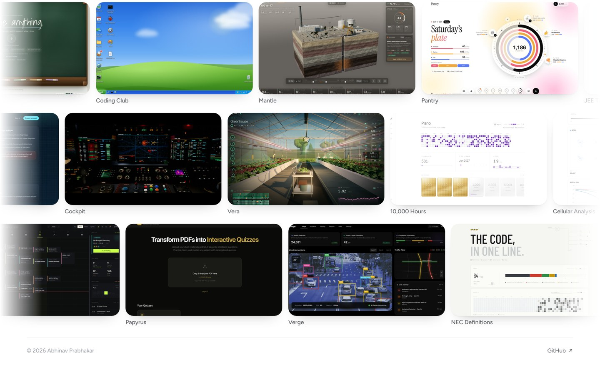
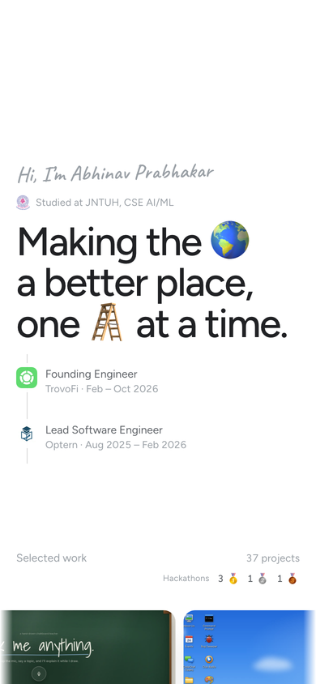

# Portfolio

Making the world a better place, one ladder at a time.

**Live:** https://abhinav-prabhakar.github.io/Portfolio/







Plain HTML, CSS and JavaScript. No framework, no build.

## Run

```sh
python3 -m http.server 4173
```

Open <http://127.0.0.1:4173>. `main` is the site; a push deploys it.
